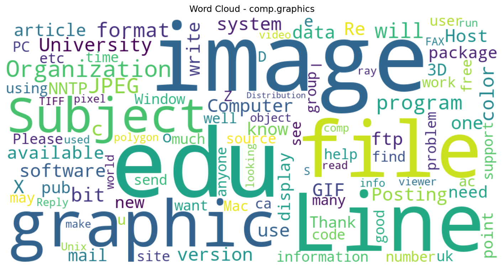
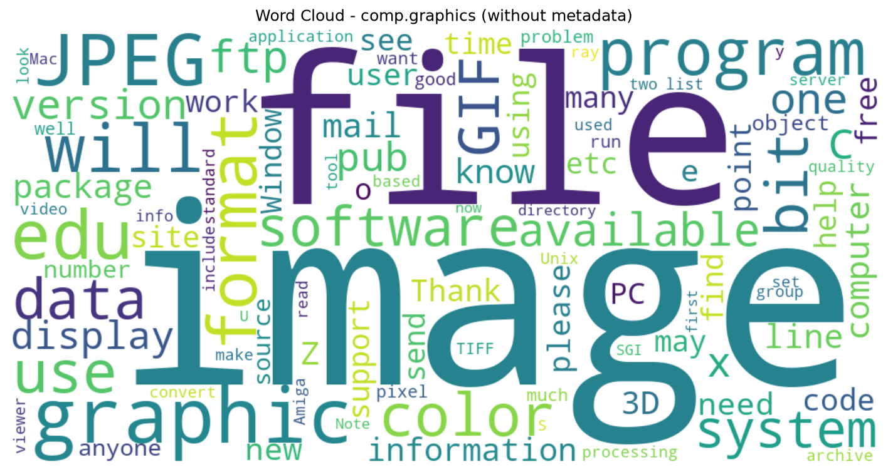
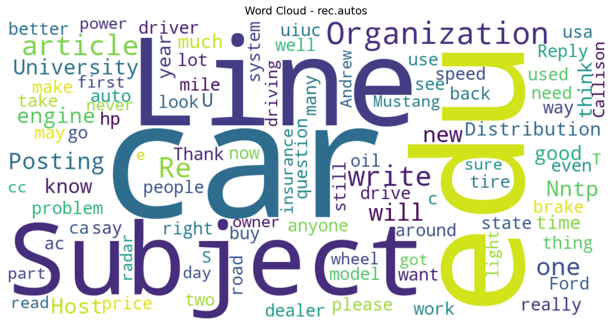
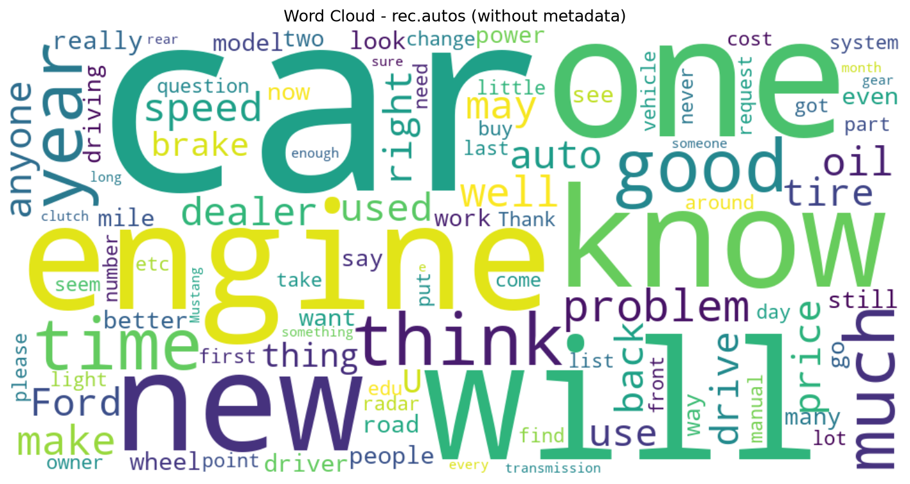
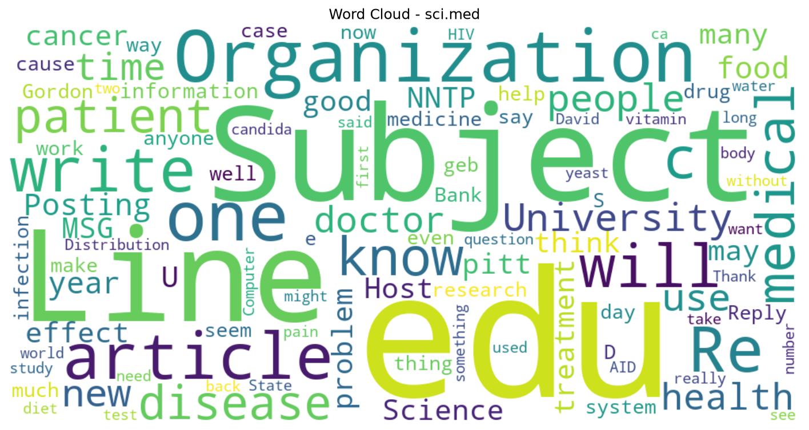
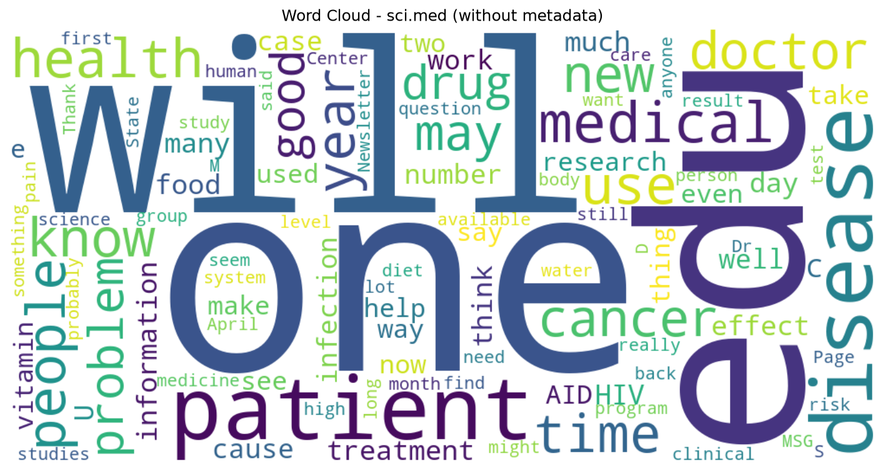
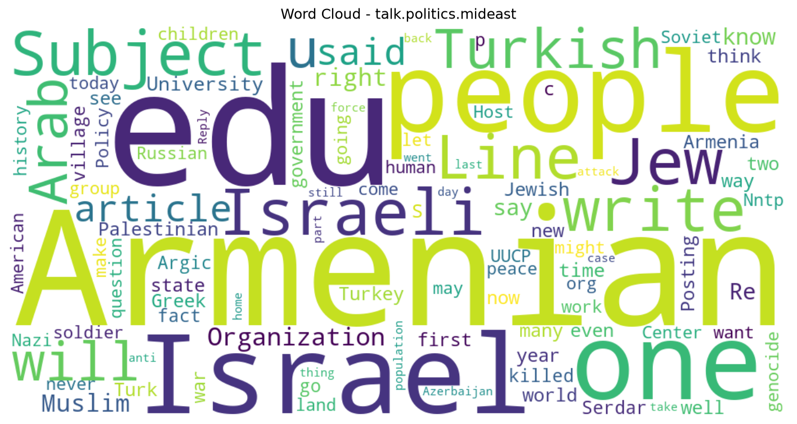
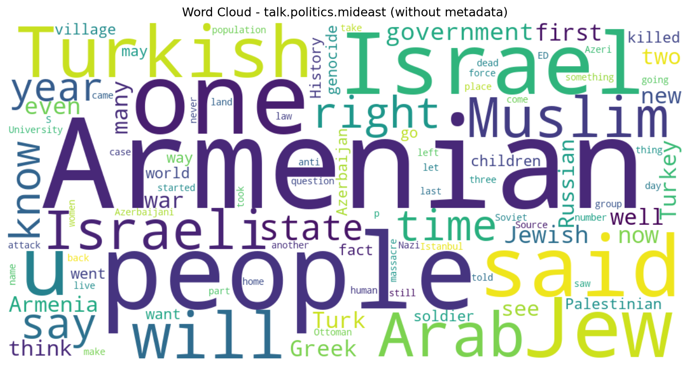

# Laboratorul 1 — Preprocesarea textului și Machine Learning clasic

## Cerința 1 — Curățarea textului cu Regex și analiza Word Cloud

### 1. Obiectiv

Scopul acestei cerințe este preprocesarea și analiza exploratorie a textelor din datasetul **20 Newsgroups**, utilizând expresii regulate (Regex) și reprezentări vizuale de tip *Word Cloud*.

Etapele urmărite sunt:
- Încărcarea datasetului și selectarea a patru categorii distincte.
- Eliminarea URL-urilor și normalizarea spațiilor folosind expresii regulate.
- Generarea unui Word Cloud pentru fiecare categorie, prin eliminarea cuvintelor uzuale (*stopwords*).
- Compararea rezultatelor obținute înainte și după eliminarea metadatelor și a textelor citate.

### 2. Descrierea datasetului

Datasetul **20 Newsgroups** conține mesaje provenite din grupuri de discuții online, organizate în 20 de categorii tematice.

Pentru acest laborator au fost selectate următoarele patru categorii, folosind funcția `fetch_20newsgroups()` din biblioteca `scikit-learn`:

| Categorie | Descriere | Număr articole |
|---|---|---:|
| `comp.graphics` | Grafică pe calculator | 973 |
| `rec.autos` | Automobile | 990 |
| `sci.med` | Medicină | 990 |
| `talk.politics.mideast` | Politică și conflicte din Orientul Mijlociu | 940 |
| **Total** | | **3893** |

A fost utilizat parametrul `subset="all"`, pentru includerea tuturor articolelor disponibile din cele patru categorii.

### 3. Preprocesarea textului

Curățarea textului a fost realizată folosind modulul `re` din Python.

Au fost aplicate două operații:

**a) Eliminarea URL-urilor**

```python
text = re.sub(r"https?://\S+|www\.\S+", "", text)
```

Expresia regulată identifică adresele URL care încep cu `http://`, `https://` sau `www.` și le înlocuiește cu un șir gol.

**b) Normalizarea spațiilor**

```python
text = re.sub(r"\s+", " ", text)
```

Această expresie înlocuiește secvențele consecutive de caractere whitespace (spații, taburi și linii noi) cu un singur spațiu.

La final, metoda `strip()` elimină spațiile de la începutul și sfârșitul textului.

Preprocesarea a fost aplicată tuturor celor 3893 de articole, fără modificarea numărului de documente.

### 4. Generarea Word Clouds

Pentru fiecare categorie, articolele preprocesate au fost reunite într-un singur text, utilizând metoda `join()`.

Au fost generate patru reprezentări vizuale de tip Word Cloud folosind biblioteca `wordcloud`.

Parametrii principali utilizați:
- `width=1000`, `height=500` — dimensiunile imaginii.
- `background_color="white"` — fundal alb.
- `stopwords=STOPWORDS` — eliminarea cuvintelor uzuale.
- `max_words=100` — afișarea a maximum 100 de cuvinte.
- `collocations=False` — dezactivarea detectării expresiilor formate din mai multe cuvinte.

Dimensiunea fiecărui cuvânt reflectă frecvența sa relativă în textul categoriei respective.

#### 4.1. Rezultatele pentru datasetul original

În prima etapă au fost generate Word Clouds folosind articolele originale, după eliminarea URL-urilor și normalizarea spațiilor.

Rezultatele au evidențiat atât cuvinte specifice fiecărei categorii, cât și termeni precum `Subject`, `Organization`, `University`, `Posting` și `NNTP`.

Acești termeni provin în principal din antetele mesajelor și din alte informații auxiliare prezente în dataset.

Deși au fost eliminate stopwords, termenii asociați metadatelor au rămas vizibili, deoarece nu fac parte din lista standard de cuvinte uzuale.

#### 4.2. Rezultatele după eliminarea metadatelor

Pentru a analiza influența acestor informații asupra rezultatelor, datasetul a fost încărcat din nou folosind:

```python
remove=("headers", "footers", "quotes")
```

Această opțiune încearcă să elimine antetele, subsolurile și fragmentele citate din alte mesaje.

Au fost aplicate aceleași operații de curățare și aceiași parametri pentru generarea Word Clouds.

După această modificare, cuvintele specifice fiecărei categorii au devenit mai vizibile:

| Categorie | Cuvinte reprezentative |
|---|---|
| `comp.graphics` | image, file, JPEG, graphic, program |
| `rec.autos` | car, engine, brake, tire, Ford |
| `sci.med` | patient, doctor, health, medical, cancer |
| `talk.politics.mideast` | Armenian, Israel, Turkish, Arab, Muslim |

Totuși, au rămas vizibile și cuvinte generale, precum `one`, `will`, `know` sau `time`, deoarece lista standard de stopwords nu elimină toate cuvintele cu relevanță tematică redusă.

### 5. Comparația rezultatelor

Pentru fiecare categorie, sunt prezentate alăturat imaginile obținute din datasetul original și cele obținute după eliminarea antetelor, subsolurilor și citatelor. Imaginile sunt salvate în directoarele `results/original/` și `results/without_metadata/`.

#### comp.graphics

| Cu metadate (original) | Fără metadate |
|:---:|:---:|
|  |  |

#### rec.autos

| Cu metadate (original) | Fără metadate |
|:---:|:---:|
|  |  |

#### sci.med

| Cu metadate (original) | Fără metadate |
|:---:|:---:|
|  |  |

#### talk.politics.mideast

| Cu metadate (original) | Fără metadate |
|:---:|:---:|
|  |  |

**Notă:** Dimensiunea cuvintelor este calculată relativ la fiecare Word Cloud. Prin urmare, comparația vizuală indică schimbări de predominanță a termenilor, nu măsoară direct diferențe de frecvență absolută între imagini.

Compararea celor două seturi de Word Clouds a evidențiat următoarele aspecte:

1. În datasetul original, metadatele influențau frecvența cuvintelor, determinând apariția unor termeni care nu descriau direct subiectul articolelor.
2. După eliminarea antetelor, subsolurilor și citatelor, termenii specifici fiecărei categorii au devenit mai proeminenți.
3. Eliminarea stopwords contribuie la îmbunătățirea reprezentării vizuale, dar nu garantează păstrarea exclusivă a cuvintelor de conținut (*content words*).
4. Eliminarea metadatelor poate fi utilă pentru analiza tematică, dar trebuie aplicată cu atenție în analiza stilometrică, deoarece unele informații eliminate pot conține indicii despre stilul autorului.

### 6. Concluzii

Experimentul evidențiază importanța preprocesării textului în analiza datelor nestructurate.

Eliminarea URL-urilor și normalizarea spațiilor reprezintă operații de bază, însă acestea nu sunt întotdeauna suficiente pentru obținerea unor reprezentări vizuale relevante.

Compararea Word Clouds generate înainte și după eliminarea metadatelor arată că informațiile auxiliare pot influența semnificativ distribuția cuvintelor și interpretarea rezultatelor.

Prin urmare, alegerea etapelor de preprocesare trebuie realizată în funcție de obiectivul analizei, deoarece eliminarea anumitor informații poate îmbunătăți analiza tematică, dar poate reduce informația disponibilă pentru alte tipuri de analiză, precum cea stilometrică.