# Laboratorul 1 — Preprocesarea textului și Machine Learning clasic

## Cerința 1 — Curățarea textului cu Regex și analiza Word Cloud

### 1. Obiectiv

Scopul acestei cerințe este preprocesarea și analiza exploratorie a textelor din datasetul **20 Newsgroups**, utilizând expresii regulate (Regex) și reprezentări vizuale de tip *Word Cloud*.

Etapele urmărite sunt:
- Încărcarea datasetului și selectarea a patru categorii distincte.
- Eliminarea URL-urilor și normalizarea spațiilor folosind expresii regulate.
- Generarea unui Word Cloud pentru fiecare categorie, prin eliminarea cuvintelor uzuale (*stopwords*).
- Compararea rezultatelor obținute înainte și după eliminarea metadatelor și a textelor citate.

### 2. Descrierea datasetului

Datasetul **20 Newsgroups** conține mesaje provenite din grupuri de discuții online, organizate în 20 de categorii tematice.

Pentru acest laborator au fost selectate următoarele patru categorii, folosind funcția `fetch_20newsgroups()` din biblioteca `scikit-learn`:

| Categorie | Descriere | Număr articole |
|---|---|---:|
| `comp.graphics` | Grafică pe calculator | 973 |
| `rec.autos` | Automobile | 990 |
| `sci.med` | Medicină | 990 |
| `talk.politics.mideast` | Politică și conflicte din Orientul Mijlociu | 940 |
| **Total** | | **3893** |

A fost utilizat parametrul `subset="all"`, pentru includerea tuturor articolelor disponibile din cele patru categorii.

### 3. Preprocesarea textului

Curățarea textului a fost realizată folosind modulul `re` din Python.

Au fost aplicate două operații:

**a) Eliminarea URL-urilor**

```python
text = re.sub(r"https?://\S+|www\.\S+", "", text)
```

Expresia regulată identifică adresele URL care încep cu `http://`, `https://` sau `www.` și le înlocuiește cu un șir gol.

**b) Normalizarea spațiilor**

```python
text = re.sub(r"\s+", " ", text)
```

Această expresie înlocuiește secvențele consecutive de caractere whitespace (spații, taburi și linii noi) cu un singur spațiu.

La final, metoda `strip()` elimină spațiile de la începutul și sfârșitul textului.

Preprocesarea a fost aplicată tuturor celor 3893 de articole, fără modificarea numărului de documente.

### 4. Generarea Word Clouds

Pentru fiecare categorie, articolele preprocesate au fost reunite într-un singur text, utilizând metoda `join()`.

Au fost generate patru reprezentări vizuale de tip Word Cloud folosind biblioteca `wordcloud`.

Parametrii principali utilizați:
- `width=1000`, `height=500` — dimensiunile imaginii.
- `background_color="white"` — fundal alb.
- `stopwords=STOPWORDS` — eliminarea cuvintelor uzuale.
- `max_words=100` — afișarea a maximum 100 de cuvinte.
- `collocations=False` — dezactivarea detectării expresiilor formate din mai multe cuvinte.

Dimensiunea fiecărui cuvânt reflectă frecvența sa relativă în textul categoriei respective.

#### 4.1. Rezultatele pentru datasetul original

În prima etapă au fost generate Word Clouds folosind articolele originale, după eliminarea URL-urilor și normalizarea spațiilor.

Rezultatele au evidențiat atât cuvinte specifice fiecărei categorii, cât și termeni precum `Subject`, `Organization`, `University`, `Posting` și `NNTP`.

Acești termeni provin în principal din antetele mesajelor și din alte informații auxiliare prezente în dataset.

Deși au fost eliminate stopwords, termenii asociați metadatelor au rămas vizibili, deoarece nu fac parte din lista standard de cuvinte uzuale.

#### 4.2. Rezultatele după eliminarea metadatelor

Pentru a analiza influența acestor informații asupra rezultatelor, datasetul a fost încărcat din nou folosind:

```python
remove=("headers", "footers", "quotes")
```

Această opțiune încearcă să elimine antetele, subsolurile și fragmentele citate din alte mesaje.

Au fost aplicate aceleași operații de curățare și aceiași parametri pentru generarea Word Clouds.

După această modificare, cuvintele specifice fiecărei categorii au devenit mai vizibile:

| Categorie | Cuvinte reprezentative |
|---|---|
| `comp.graphics` | image, file, JPEG, graphic, program |
| `rec.autos` | car, engine, brake, tire, Ford |
| `sci.med` | patient, doctor, health, medical, cancer |
| `talk.politics.mideast` | Armenian, Israel, Turkish, Arab, Muslim |

Totuși, au rămas vizibile și cuvinte generale, precum `one`, `will`, `know` sau `time`, deoarece lista standard de stopwords nu elimină toate cuvintele cu relevanță tematică redusă.

### 5. Comparația rezultatelor

Pentru fiecare categorie, sunt prezentate alăturat imaginile obținute din datasetul original și cele obținute după eliminarea antetelor, subsolurilor și citatelor. Imaginile sunt salvate în directoarele `results/original/` și `results/without_metadata/`.

#### comp.graphics

| Cu metadate (original) | Fără metadate |
|:---:|:---:|
|  |  |

#### rec.autos

| Cu metadate (original) | Fără metadate |
|:---:|:---:|
|  |  |

#### sci.med

| Cu metadate (original) | Fără metadate |
|:---:|:---:|
|  |  |

#### talk.politics.mideast

| Cu metadate (original) | Fără metadate |
|:---:|:---:|
|  |  |

**Notă:** Dimensiunea cuvintelor este calculată relativ la fiecare Word Cloud. Prin urmare, comparația vizuală indică schimbări de predominanță a termenilor, nu măsoară direct diferențe de frecvență absolută între imagini.

Compararea celor două seturi de Word Clouds a evidențiat următoarele aspecte:

1. În datasetul original, metadatele influențau frecvența cuvintelor, determinând apariția unor termeni care nu descriau direct subiectul articolelor.
2. După eliminarea antetelor, subsolurilor și citatelor, termenii specifici fiecărei categorii au devenit mai proeminenți.
3. Eliminarea stopwords contribuie la îmbunătățirea reprezentării vizuale, dar nu garantează păstrarea exclusivă a cuvintelor de conținut (*content words*).
4. Eliminarea metadatelor poate fi utilă pentru analiza tematică, dar trebuie aplicată cu atenție în analiza stilometrică, deoarece unele informații eliminate pot conține indicii despre stilul autorului.

### 6. Concluzii

Experimentul evidențiază importanța preprocesării textului în analiza datelor nestructurate.

Eliminarea URL-urilor și normalizarea spațiilor reprezintă operații de bază, însă acestea nu sunt întotdeauna suficiente pentru obținerea unor reprezentări vizuale relevante.

Compararea Word Clouds generate înainte și după eliminarea metadatelor arată că informațiile auxiliare pot influența semnificativ distribuția cuvintelor și interpretarea rezultatelor.

Prin urmare, alegerea etapelor de preprocesare trebuie realizată în funcție de obiectivul analizei, deoarece eliminarea anumitor informații poate îmbunătăți analiza tematică, dar poate reduce informația disponibilă pentru alte tipuri de analiză, precum cea stilometrică.

---

# Cerința 2 — Extragerea și analiza caracteristicilor lingvistice (spaCy)

## 1. Obiectiv

Scopul acestei cerințe este extragerea și analiza unor caracteristici lingvistice din articolele datasetului **20 Newsgroups**, utilizând biblioteca `spaCy`.

Caracteristicile lingvistice pot oferi informații despre diversitatea vocabularului, lungimea propozițiilor, complexitatea sintactică și utilizarea anumitor categorii gramaticale.

Au fost urmărite următoarele obiective:

- Preprocesarea și analiza articolelor folosind spaCy.
- Extragerea a șapte caracteristici lingvistice pentru fiecare articol.
- Organizarea rezultatelor într-un tabel și salvarea acestora în format CSV.
- Vizualizarea distribuțiilor caracteristicilor pentru cele patru categorii.
- Identificarea diferențelor lingvistice care ar putea contribui la clasificarea automată a textelor.

## 2. Pregătirea datelor

A fost utilizat același dataset **20 Newsgroups**, cu următoarele categorii:

| Categorie | Număr articole |
|---|---:|
| `comp.graphics` | 973 |
| `rec.autos` | 990 |
| `sci.med` | 990 |
| `talk.politics.mideast` | 940 |
| **Total** | **3893** |

Pentru această etapă a fost folosită varianta datasetului fără antete, subsoluri și texte citate, prin parametrul:

```python
remove=("headers", "footers", "quotes")
```

Ulterior, au fost aplicate aceleași operații Regex utilizate în prima cerință: eliminarea URL-urilor și normalizarea spațiilor.

Textele rezultate au fost procesate cu modelul lingvistic `en_core_web_sm` din biblioteca spaCy.

Pentru procesarea eficientă a documentelor a fost utilizată metoda `nlp.pipe()`, cu `batch_size=64`.

## 3. Caracteristicile lingvistice extrase

Au fost implementate șapte caracteristici lingvistice, calculate individual pentru fiecare articol.

| Caracteristică | Descriere |
|---|---|
| **Type-Token Ratio (TTR)** | Raportul dintre numărul cuvintelor distincte și numărul total de cuvinte |
| **Words per Sentence** | Numărul mediu de cuvinte pe propoziție |
| **Nouns per Sentence** | Numărul mediu de substantive comune și proprii pe propoziție |
| **Dependency Parse Depth** | Adâncimea medie a cuvintelor față de rădăcina arborelui sintactic |
| **Average Word Length** | Numărul mediu de caractere din cuvinte |
| **Named Entity Density** | Proporția cuvintelor alfabetice care fac parte din entități numite |
| **Adjective Ratio** | Proporția adjectivelor din totalul cuvintelor |

Pentru identificarea cuvintelor au fost selectate tokenurile alfabetice, folosind proprietatea `token.is_alpha`.

Pentru identificarea substantivelor și adjectivelor au fost utilizate etichetele POS generate de spaCy: `NOUN`, `PROPN` și `ADJ`.

Adâncimea sintactică a fost calculată prin parcurgerea relațiilor de dependență de la fiecare token până la rădăcina propoziției.

Densitatea entităților numite a fost calculată utilizând adnotările NER ale spaCy, prin identificarea tokenurilor care aparțin unor entități.

## 4. Extragerea și organizarea rezultatelor

Cele șapte caracteristici au fost calculate pentru toate cele 3893 de articole.

Rezultatele au fost organizate într-un `pandas.DataFrame`, conținând identificatorul articolului, categoria acestuia și valorile celor șapte caracteristici.

Tabelul rezultat are dimensiunea **3893 × 9** și a fost salvat în:

`results/linguistic_features/features.csv`

În urma preprocesării au fost identificate **128 de articole fără cuvinte alfabetice**, pentru care caracteristicile nu au putut fi calculate.

Aceste valori au fost marcate ca lipsă (`NaN`), în loc să fie înlocuite cu zero, pentru a evita influențarea artificială a rezultatelor.

Pentru analiza distribuțiilor au fost utilizate cele **3765 de articole cu valori valide**, reprezentând aproximativ 96,7% din dataset.

## 5. Analiza distribuțiilor caracteristicilor

Pentru compararea celor patru categorii au fost generate două tipuri de grafice:

- **Boxplot-uri**, pentru evidențierea medianei, a intervalului intercuartilic și a variației caracteristicilor în interiorul fiecărei categorii.
- **Grafice cu bare orizontale**, pentru compararea directă a valorilor mediane.

În reprezentările boxplot îmbunătățite, punctele corespunzătoare valorilor extreme nu au fost afișate separat, pentru a facilita interpretarea distribuțiilor. Aceste observații au rămas incluse în calcule.

### 5.1. Comparația valorilor mediane

Tabelul următor prezintă valorile mediane obținute pentru cele șapte caracteristici.

| Caracteristică | Grafică | Automobile | Medicină | Politică |
|---|---:|---:|---:|---:|
| TTR | **0,778** | 0,758 | 0,724 | 0,657 |
| Words per Sentence | 12,500 | 13,167 | 14,400 | **15,000** |
| Nouns per Sentence | 4,000 | 3,600 | 3,750 | **4,059** |
| Dependency Depth | 2,562 | 2,455 | 2,636 | **2,809** |
| Average Word Length | 4,368 | 4,208 | 4,580 | **4,596** |
| Named Entity Density | 0,059 | 0,062 | 0,044 | **0,116** |
| Adjective Ratio | 0,059 | 0,068 | **0,080** | 0,073 |

### 5.2. Diversitatea vocabularului (TTR)

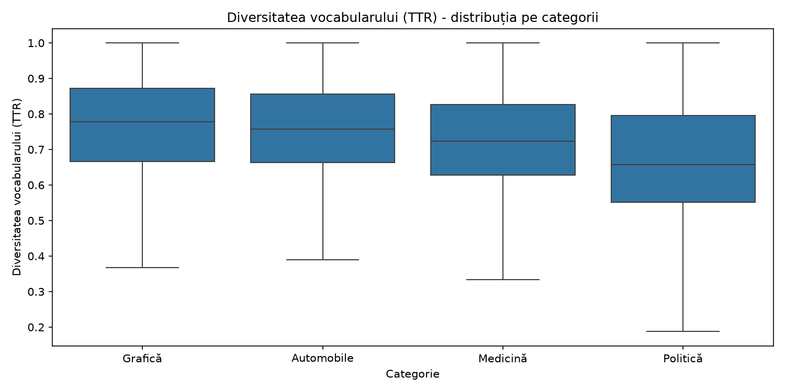

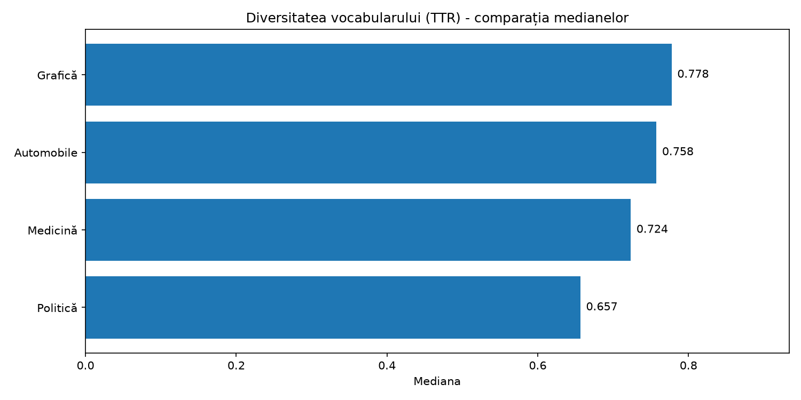

Categoria `comp.graphics` prezintă cea mai mare valoare mediană TTR (0,778), urmată de `rec.autos` (0,758) și `sci.med` (0,724).

Categoria `talk.politics.mideast` prezintă cea mai mică mediană (0,657).

Aceste rezultate indică diferențe între diversitățile lexicale măsurate la nivelul articolelor.

Totuși, TTR este influențat de lungimea textului, astfel încât diferențele observate nu pot fi atribuite exclusiv vocabularului utilizat în fiecare categorie.

### 5.3. Numărul mediu de cuvinte pe propoziție

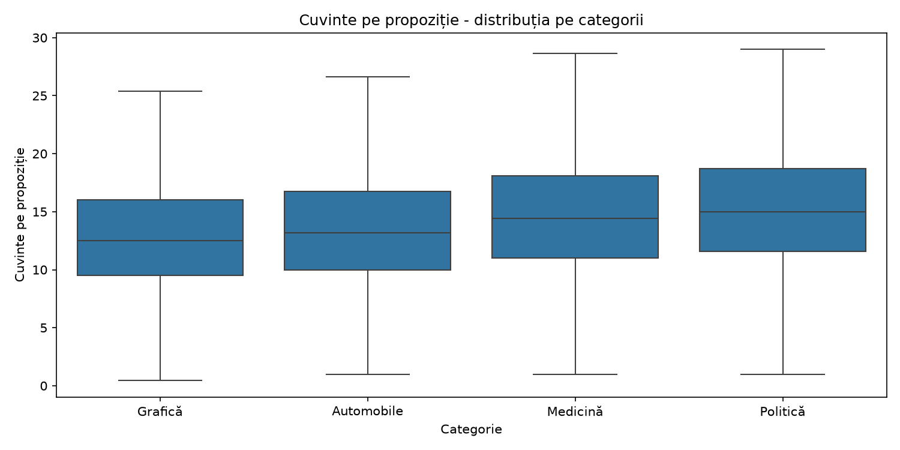

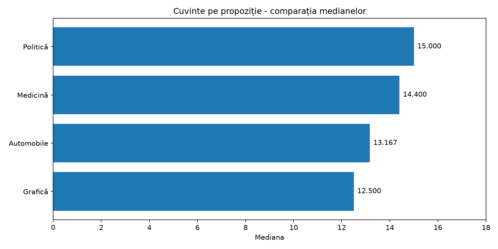

Articolele din categoria `talk.politics.mideast` prezintă cea mai mare mediană a lungimii propozițiilor, de 15 cuvinte.

Categoria `sci.med` urmează cu o mediană de 14,4 cuvinte, în timp ce `comp.graphics` prezintă cea mai mică valoare, de 12,5 cuvinte.

Rezultatele sugerează că articolele politice și medicale tind să conțină propoziții mai lungi decât cele din domeniul graficii pe calculator.

Totuși, distribuțiile se suprapun, ceea ce indică o variație importantă a lungimii propozițiilor în interiorul fiecărei categorii.

### 5.4. Numărul mediu de substantive pe propoziție

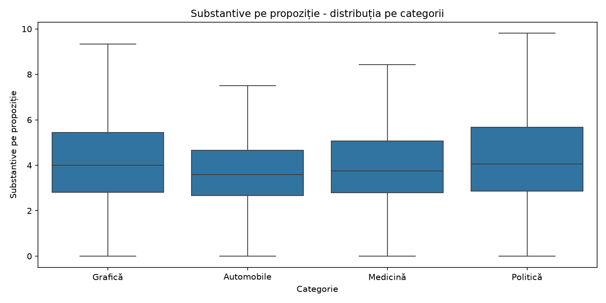

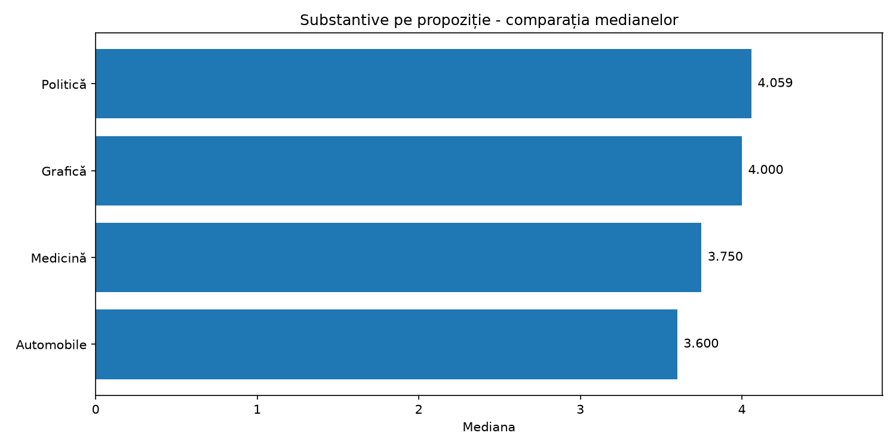

Categoria `talk.politics.mideast` prezintă cea mai mare mediană, de aproximativ 4,06 substantive pe propoziție, urmată îndeaproape de `comp.graphics`, cu 4 substantive.

Categoria `rec.autos` prezintă cea mai mică valoare mediană, de 3,6 substantive.

Diferențele dintre categorii sunt relativ reduse, iar boxplot-urile prezintă suprapuneri considerabile.

Prin urmare, această caracteristică pare să ofere o capacitate limitată de diferențiere atunci când este analizată individual.

### 5.5. Adâncimea sintactică medie

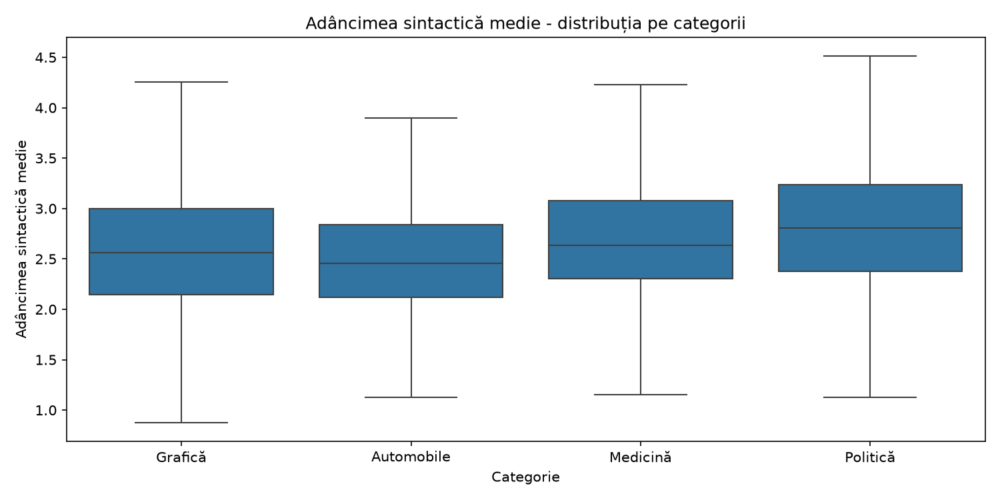

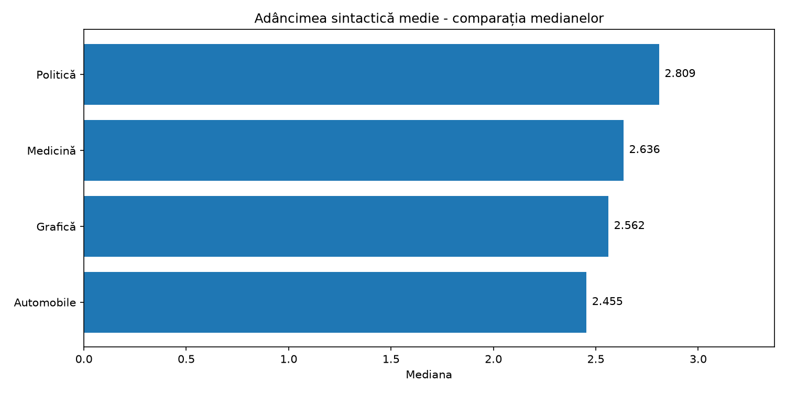

Categoria `talk.politics.mideast` are cea mai mare mediană a adâncimii sintactice (2,809), în timp ce `rec.autos` prezintă cea mai mică valoare (2,455).

Acest rezultat sugerează că articolele politice pot utiliza structuri sintactice mai elaborate decât cele despre automobile.

Caracteristica este însă influențată și de lungimea propozițiilor, iar adâncimea arborelui sintactic nu reprezintă singură o măsură completă a complexității gramaticale.

### 5.6. Lungimea medie a cuvintelor

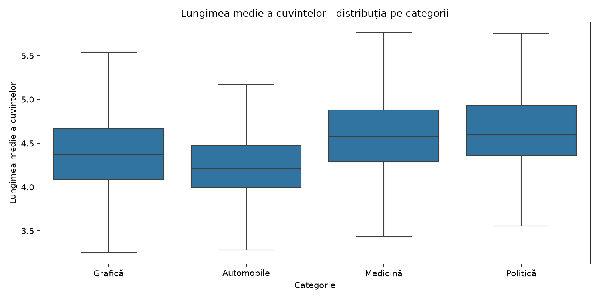

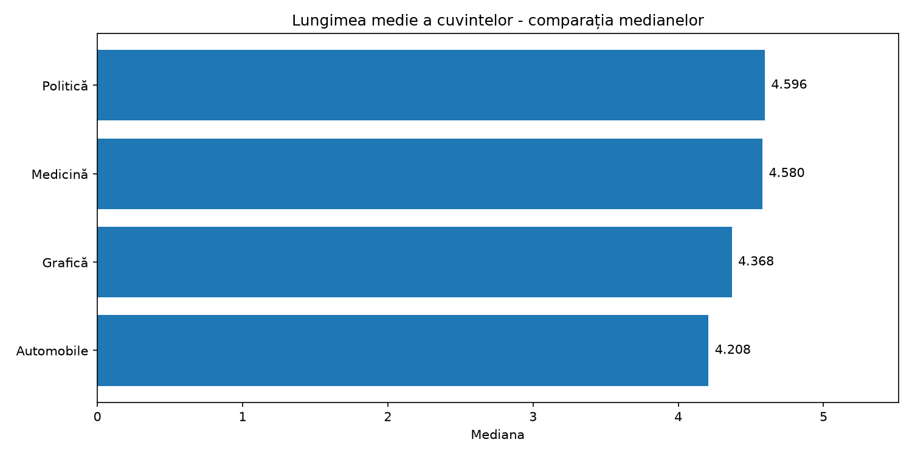

Cele mai mari mediane au fost obținute pentru categoriile `talk.politics.mideast` (4,596 caractere) și `sci.med` (4,580 caractere).

Categoria `rec.autos` prezintă cea mai mică valoare (4,208 caractere).

Rezultatele pot fi asociate cu utilizarea unor termeni mai lungi în textele medicale și politice, comparativ cu vocabularul conversațional întâlnit în discuțiile despre automobile.

Totuși, diferențele nu sunt suficient de mari pentru a separa clar toate categoriile.

### 5.7. Densitatea entităților numite

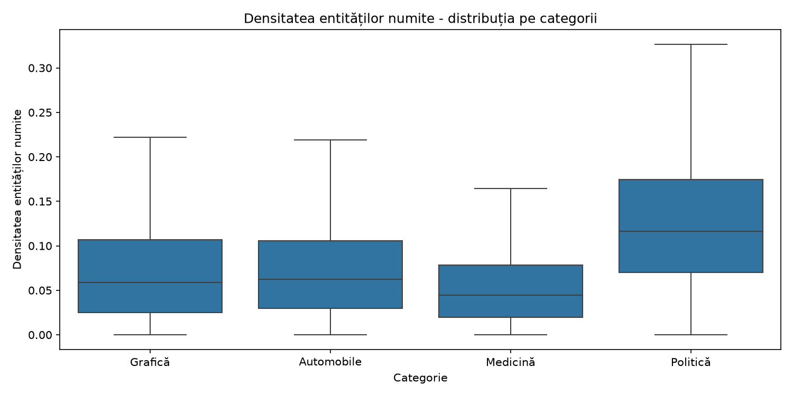

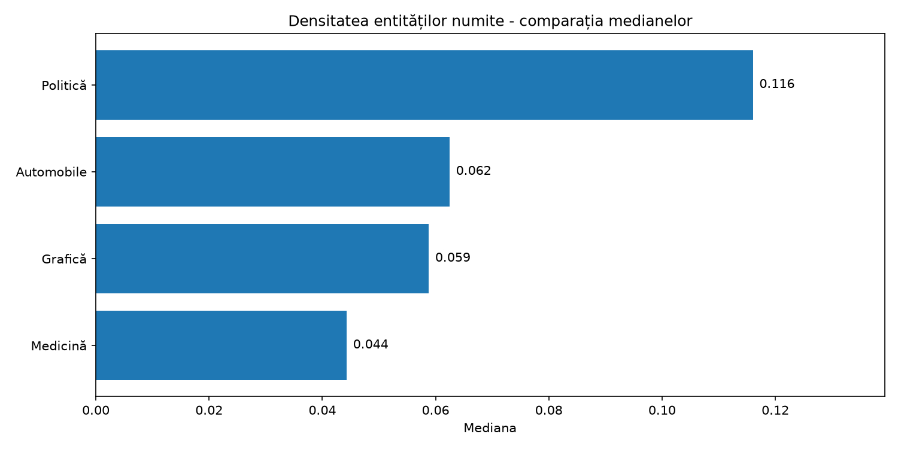

Această caracteristică prezintă una dintre cele mai evidente diferențe între categorii.

Categoria `talk.politics.mideast` are o mediană de 0,116, ceea ce înseamnă că, pentru articolul situat la mediana distribuției, aproximativ 11,6% dintre cuvintele alfabetice fac parte din entități numite identificate de spaCy.

În comparație, categoria `sci.med` prezintă o mediană de numai 0,044 (4,4%).

O explicație posibilă este utilizarea frecventă în articolele politice a numelor de persoane, țări, regiuni, organizații și grupuri etnice sau religioase.

Prin urmare, densitatea entităților numite pare a fi una dintre caracteristicile cu potențial discriminativ ridicat pentru diferențierea categoriei politice.

### 5.8. Proporția adjectivelor

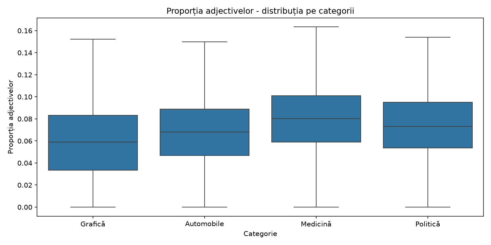

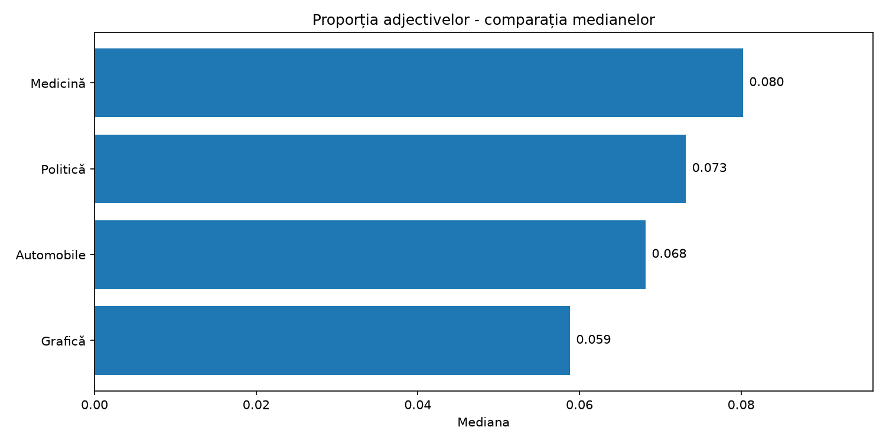

Categoria `sci.med` prezintă cea mai mare mediană a proporției adjectivelor (0,080), urmată de `talk.politics.mideast` (0,073).

Categoria `comp.graphics` are cea mai mică valoare mediană (0,059).

O posibilă explicație este prezența frecventă a construcțiilor descriptive în textele medicale, precum *chronic disease*, *clinical study* sau *medical treatment*.

Cu toate acestea, distribuțiile se suprapun, ceea ce sugerează că proporția adjectivelor este mai utilă în combinație cu alte caracteristici decât individual.

## 6. Identificarea tiparelor discriminative

Analiza comparativă a evidențiat mai multe diferențe lingvistice între cele patru categorii.

Cele mai importante observații sunt:

1. **Densitatea entităților numite** diferențiază vizibil categoria politică de celelalte categorii, aceasta având cea mai mare valoare mediană.
2. **Diversitatea lexicală (TTR)** are cele mai mari valori mediane în articolele despre grafică și automobile, dar este influențată de lungimea documentelor.
3. **Lungimea propozițiilor și adâncimea sintactică** prezintă valori centrale mai mari pentru categoria politică.
4. **Lungimea medie a cuvintelor** este mai ridicată în articolele medicale și politice.
5. **Proporția adjectivelor** este cea mai mare în categoria medicală.
6. **Numărul substantivelor pe propoziție** prezintă diferențe relativ mici și suprapuneri importante între categorii.

Deși se observă diferențe între valorile mediane, distribuțiile caracteristicilor se suprapun în numeroase situații.

Astfel, nicio caracteristică analizată individual nu garantează diferențierea corectă a tuturor articolelor.

Combinarea acestora într-un model de Machine Learning ar putea însă contribui la îmbunătățirea clasificării.

## 7. Limitări

Analiza prezintă câteva limitări importante.

În primul rând, eliminarea antetelor, subsolurilor și citatelor reduce informațiile auxiliare, dar poate elimina și unele elemente relevante pentru analiza stilometrică.

În al doilea rând, segmentarea propozițiilor, identificarea părților de vorbire, analiza dependențelor sintactice și recunoașterea entităților sunt realizate automat de spaCy și pot conține erori.

În al treilea rând, caracteristica TTR depinde de lungimea documentelor, ceea ce limitează interpretarea comparațiilor directe între articole de dimensiuni diferite.

De asemenea, diferențele dintre valorile mediane nu demonstrează automat existența unei capacități predictive ridicate. Aceasta trebuie evaluată ulterior prin antrenarea și testarea unor modele de clasificare.

## 8. Concluzii

În cadrul acestei cerințe au fost extrase și analizate șapte caracteristici lingvistice pentru articolele din cele patru categorii ale datasetului 20 Newsgroups.

Rezultatele au evidențiat diferențe privind diversitatea vocabularului, lungimea propozițiilor, utilizarea substantivelor și adjectivelor, complexitatea sintactică și densitatea entităților numite.

Dintre caracteristicile analizate, densitatea entităților numite prezintă una dintre cele mai clare diferențe între categorii, în special pentru articolele politice.

Analiza demonstrează că proprietățile lingvistice pot oferi informații relevante despre structura și stilul textelor, fiind potențial utile în clasificarea automată.

Totuși, suprapunerea distribuțiilor arată că utilizarea unei singure caracteristici este insuficientă pentru separarea completă a claselor.

Prin urmare, etapa următoare poate urmări combinarea acestor caracteristici și evaluarea lor prin algoritmi clasici de Machine Learning.

---

# Cerința 3 — Clasificarea textelor folosind Machine Learning

## 1. Obiectiv

Scopul acestei cerințe este clasificarea automată a articolelor din datasetul 20 Newsgroups în cele patru categorii: `comp.graphics`, `rec.autos`, `sci.med` și `talk.politics.mideast`.

Au fost comparate două tipuri de algoritmi, **Support Vector Machine (SVM)** și **Multi-Layer Perceptron (MLP)**, utilizând diferite reprezentări ale textelor.

## 2. Pregătirea datelor

Au fost utilizate cele 3765 de articole pentru care au putut fi calculate caracteristicile lingvistice în cerința 2.

Datele au fost împărțite în:

- **80% antrenare:** 3012 articole.
- **20% testare:** 753 articole.

Împărțirea a fost realizată folosind `train_test_split()` cu `stratify=y`, pentru păstrarea proporțiilor categoriilor.

Normalizarea caracteristicilor numerice a fost realizată cu `StandardScaler`, folosind exclusiv datele de antrenare pentru calcularea parametrilor.

## 3. Reprezentările textuale

Au fost utilizate trei tipuri principale de reprezentări:

**Caracteristici lingvistice:** cele șapte caracteristici extrase cu spaCy în cerința anterioară.

**Bag-of-Words (BoW):** reprezentarea articolelor prin frecvențele cuvintelor, folosind `CountVectorizer` și un vocabular limitat la 10.000 de termeni.

**Word2Vec:** reprezentări vectoriale de 100 de dimensiuni, învățate din articolele de antrenare. Pentru fiecare document a fost calculată media vectorilor cuvintelor sale.

Au fost testate și combinații ale acestor reprezentări.

Pentru experimentul MLP + BoW, dimensionalitatea a fost redusă la 100 folosind `TruncatedSVD`.

## 4. Modelele antrenate

Au fost realizate șapte experimente:

| Model | Reprezentare | Accuracy | Macro-F1 |
|---|---|---:|---:|
| SVM | Caracteristici lingvistice | 51,00% | 0,5134 |
| SVM | Bag-of-Words | 89,24% | 0,8923 |
| **SVM** | **BoW + caracteristici lingvistice** | **90,31%** | **0,9029** |
| SVM | Word2Vec | 82,34% | 0,8239 |
| MLP | Word2Vec | 79,81% | 0,7995 |
| MLP | Word2Vec + caracteristici lingvistice | 83,40% | 0,8342 |
| MLP | BoW + TruncatedSVD | 77,69% | 0,7771 |

Performanțele au fost evaluate folosind Accuracy și Macro-F1.

## 5. Compararea performanțelor

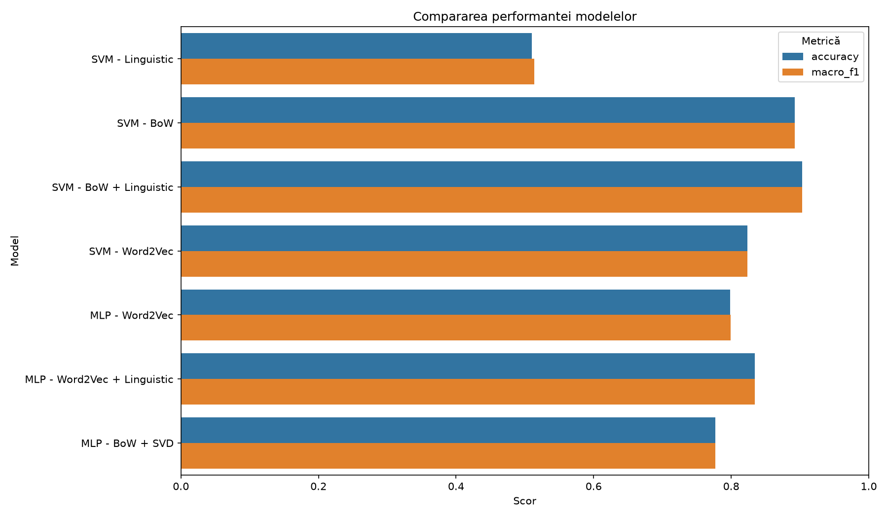

Rezultatele evidențiază câteva observații importante:

1. Modelul SVM antrenat doar pe caracteristicile lingvistice a obținut o acuratețe de 51%, indicând faptul că acestea conțin informații utile, dar insuficiente pentru clasificarea precisă a articolelor.

2. Utilizarea Bag-of-Words a crescut acuratețea SVM la 89,24%, demonstrând importanța informațiilor lexicale în identificarea subiectelor.

3. Combinarea BoW cu cele șapte caracteristici lingvistice a produs cea mai bună performanță, de 90,31%.

4. Adăugarea caracteristicilor lingvistice la Word2Vec a îmbunătățit performanța MLP de la 79,81% la 83,40%.

5. Pe reprezentarea Word2Vec, SVM a obținut o acuratețe de 82,34%, comparativ cu 79,81% pentru MLP.

6. MLP + BoW redus prin TruncatedSVD a obținut 77,69%, dar rezultatul nu este direct echivalent cu utilizarea BoW în forma sa originală.

## 6. Limitări

Rezultatele reprezintă o comparație experimentală a configurațiilor implementate, nu o demonstrație că un algoritm este universal superior altuia.

În plus, unele ajustări ale hiperparametrilor SVM au fost efectuate după inspectarea rezultatelor pe setul de test. Pentru o evaluare mai riguroasă, alegerea hiperparametrilor ar trebui realizată pe un set de validare sau prin validare încrucișată, păstrând testul exclusiv pentru evaluarea finală.

## 7. Concluzii

Experimentele arată că reprezentarea textelor influențează considerabil performanța clasificării.

Dintre configurațiile evaluate, **SVM combinat cu Bag-of-Words și caracteristicile lingvistice** a obținut cea mai mare acuratețe, de **90,31%**.

Deși caracteristicile lingvistice nu au fost suficiente individual pentru a obține o performanță ridicată, combinarea lor cu reprezentările lexicale și vectoriale a îmbunătățit rezultatele în experimentele realizate.

Astfel, informațiile despre conținutul lexical și cele despre structura lingvistică a textelor pot avea un rol complementar în clasificarea automată.