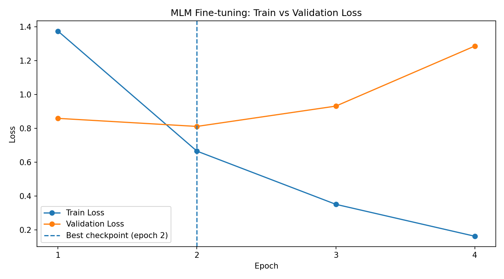
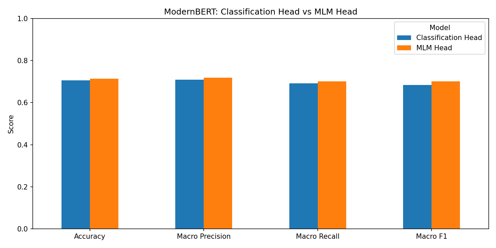

# Laboratorul 2 — Encoder Fine-tuning

## Cerința 1 — ModernBERT cu Classification Head

### 1. Obiectiv

Scopul experimentului este adaptarea (*fine-tuning*) modelului preantrenat **ModernBERT-base** pentru clasificarea articolelor din datasetul 20 Newsgroups în 20 de categorii.

A fost utilizat un encoder Transformer, urmat de un strat liniar de clasificare.

### 2. Dataset

A fost utilizat datasetul `SetFit/20_newsgroups`, din care au fost eliminate articolele cu text gol.

Datele au fost împărțite astfel:

| Set | Număr articole |
|---|---:|
| Train | 9.912 |
| Validation | 1.102 |
| Test | 7.317 |

Setul de validare reprezintă 10% din datele de antrenare inițiale și a fost obținut prin împărțire stratificată, păstrând distribuția celor 20 de categorii.

### 3. Arhitectura modelului

A fost utilizat modelul `answerdotai/ModernBERT-base`.

Arhitectura include:

- **Encoder ModernBERT** — generează reprezentări contextuale ale tokenurilor.
- **Mean pooling** — calculează media reprezentărilor tokenurilor, ignorând padding-ul.
- **Classification head** — strat liniar care transformă vectorul de 768 de dimensiuni în 20 de scoruri, câte unul pentru fiecare clasă.

Toți parametrii encoderului și ai clasificatorului au fost actualizați în timpul antrenării.

### 4. Configurarea antrenării

| Parametru | Valoare |
|---|---|
| Model | ModernBERT-base |
| Optimizer | AdamW |
| Learning rate | 5e-5 |
| Batch size | 8 |
| Gradient accumulation steps | 2 |
| Batch efectiv | 16 |
| Maximum epochs | 5 |
| Maximum sequence length | 512 |
| Early stopping patience | 3 validări consecutive |
| GPU | NVIDIA Tesla T4 |

A fost utilizată funcția de pierdere `CrossEntropyLoss`.

În timpul antrenării, modelul a fost evaluat periodic pe setul de validare, iar checkpoint-ul cu cea mai mică valoare a `validation loss` a fost salvat.

### 5. Rezultatele antrenării

În prima epocă, validation loss a scăzut progresiv, atingând valoarea minimă de **0,8174**.

Ulterior, valorile de validare nu s-au mai îmbunătățit timp de trei verificări consecutive, ceea ce a declanșat mecanismul de early stopping în timpul celei de-a doua epoci.

Pentru evaluarea finală a fost utilizat checkpoint-ul cu cea mai mică pierdere pe setul de validare.

### 6. Evaluarea pe setul de test

| Metrică | Valoare |
|---|---:|
| Accuracy | **70,66%** |
| Precision (macro) | 0,7089 |
| Recall (macro) | 0,6913 |
| F1-score (macro) | **0,6844** |

Modelul a clasificat corect aproximativ 71% dintre cele 7.317 articole din setul de test.

Performanța diferă între categorii. De exemplu, `rec.sport.hockey` a obținut un F1-score de 0,89, în timp ce `talk.religion.misc` a obținut doar 0,08.

### 7. Concluzii

Experimentul a demonstrat utilizarea unui encoder Transformer preantrenat pentru clasificarea multiclasă a textelor.

Antrenarea cu AdamW și gradient accumulation a permis adaptarea modelului ModernBERT-base pe GPU, iar mecanismul de early stopping a limitat continuarea antrenării după încetarea îmbunătățirii rezultatelor pe setul de validare.

Modelul a obținut o acuratețe de **70,66%** pe cele 20 de categorii, însă performanța neuniformă între clase indică existența unor categorii dificil de diferențiat.

Rezultatele evidențiază importanța evaluării pe clase, nu doar a acurateței globale.

---

## Cerința 2 — Evaluarea modelului

Pentru evaluare, a fost reîncărcat checkpoint-ul ModernBERT cu Classification Head, selectat pe baza celei mai mici valori a pierderii pe setul de validare.

Predicțiile au fost realizate pe setul de test, format din **7317 articole**.

### Rezultate

| Metrică | Valoare |
|---|---:|
| Accuracy | 70,66% |
| Macro Precision | 0,7089 |
| Macro Recall | 0,6913 |
| Macro F1 | 0,6844 |

Performanța modelului diferă între categorii. Cea mai mare valoare F1 a fost obținută pentru `rec.sport.hockey` (0,89), iar cea mai mică pentru `talk.religion.misc` (0,08).

Acest rezultat arată că acuratețea globală nu reflectă întotdeauna dificultatea clasificării fiecărei categorii.

## Cerința 3 — Prompting și fine-tuning cu MLM Head

### 1. Obiectiv

În această etapă a fost utilizat ModernBERT-base cu componenta preantrenată pentru *Masked Language Modeling* (MLM), fără adăugarea unui strat liniar separat pentru clasificare.

Scopul a fost clasificarea articolelor prin prezicerea unui token mascat, corespunzător uneia dintre cele 20 de categorii.

### 2. Construirea promptului

Pentru fiecare articol a fost construit un prompt care enumeră cele 20 de categorii, urmate de textul articolului și de expresia:

`Label: [MASK]`

A fost verificat că etichetele numerice `0–19` sunt reprezentate fiecare printr-un singur token al tokenizerului ModernBERT.

Pentru articolele lungi, textul a fost trunchiat astfel încât promptul să nu depășească 512 tokenuri și să păstreze poziția `[MASK]`.

La evaluare au fost comparate numai scorurile corespunzătoare celor 20 de etichete valide.

### 3. Configurarea antrenării

| Parametru | Valoare |
|---|---|
| Model | ModernBERT-base cu MLM Head |
| Optimizer | AdamW |
| Learning rate | 2e-5 |
| Batch size | 2 |
| Gradient accumulation | 8 |
| Batch efectiv | 16 |
| Număr maxim de epoci | 5 |
| Maximum sequence length | 512 |
| Early stopping patience | 2 epoci |
| GPU | NVIDIA Tesla T4 |

Au fost actualizați atât parametrii encoderului, cât și cei ai MLM Head.

### 4. Evoluția antrenării

| Epocă | Train Loss | Validation Loss |
|---|---:|---:|
| 1 | 1,3739 | 0,8590 |
| **2** | **0,6658** | **0,8114** |
| 3 | 0,3518 | 0,9313 |
| 4 | 0,1636 | 1,2855 |

Cea mai mică valoare a `validation loss` a fost obținută în **epoca 2**, când a fost salvat cel mai bun checkpoint.

În epocile 3 și 4, pierderea pe setul de antrenare a continuat să scadă, dar pierderea pe validare a crescut, indicând apariția supraînvățării (*overfitting*).

Mecanismul de early stopping a oprit antrenarea după epoca 4.

### 5. Evaluarea MLM Head

Cel mai bun checkpoint a fost reîncărcat și evaluat pe cele 7317 articole din setul de test.

| Metrică | Valoare |
|---|---:|
| Accuracy | **71,40%** |
| Macro Precision | 0,7185 |
| Macro Recall | 0,7020 |
| Macro F1 | **0,7011** |

### 6. Compararea celor două abordări

| Metrică | Classification Head | MLM Head |
|---|---:|---:|
| Accuracy | 70,66% | **71,40%** |
| Macro Precision | 0,7089 | **0,7185** |
| Macro Recall | 0,6913 | **0,7020** |
| Macro F1 | 0,6844 | **0,7011** |

Modelul bazat pe MLM Head a obținut rezultate ușor mai bune la toate cele patru metrici.

O diferență importantă apare pentru categoria `talk.religion.misc`, unde F1-score a crescut de la 0,08 la 0,34.

Totuși, modelele au fost antrenate folosind configurații diferite, astfel încât rezultatele nu demonstrează superioritatea generală a uneia dintre arhitecturi.

## Concluzii

În cadrul Laboratorului 2 au fost implementate și evaluate două abordări pentru clasificarea articolelor din 20 Newsgroups:

1. Fine-tuning ModernBERT cu un strat liniar de clasificare.
2. Fine-tuning ModernBERT cu MLM Head și predicția tokenului mascat.

Ambele abordări au obținut o acuratețe de peste 70%, iar MLM Head a înregistrat cea mai bună performanță în experimentele realizate.

Rezultatele evidențiază importanța alegerii arhitecturii de clasificare, a monitorizării pierderii pe validare și a utilizării early stopping pentru limitarea supraînvățării.